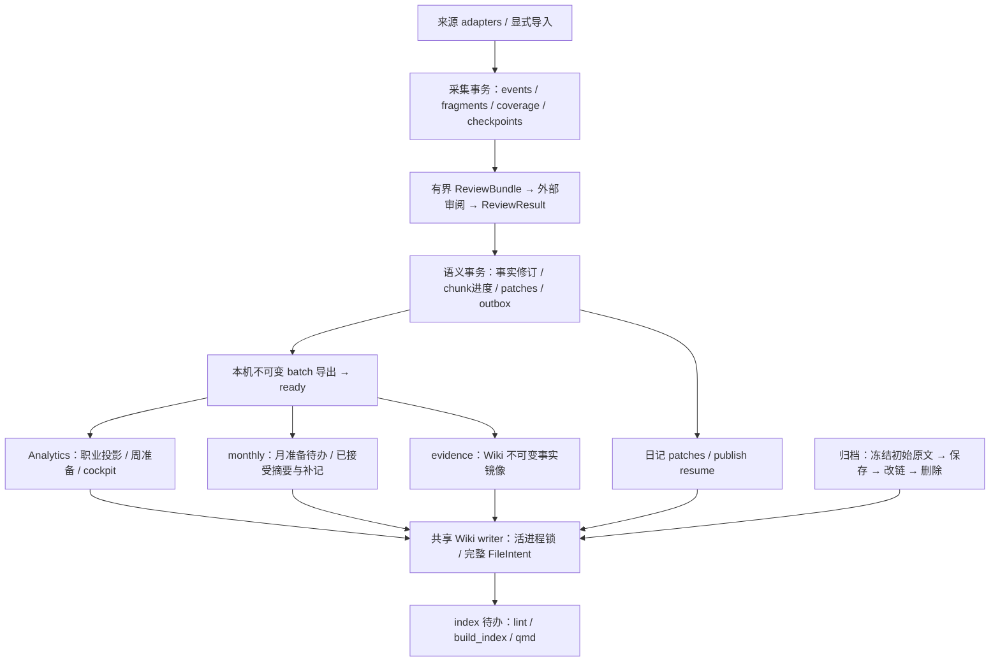

# 架构与接手顺序

本系统先保存材料，再接受事实，最后分别交付页面和消费者。业务依据是 [SPEC](../SPEC.md)，类型与端口见 [interfaces](interfaces.md)，执行步骤见 [runbook](runbook.md)。

`live` 与 `history` 使用独立范围、检查点和待办；每轮冻结 cutoff，历史缺口不会把当前日更变成全量重扫。采集完成只证明材料落盘，审阅完成才更新对应 chunk。CLI 准备有界材料，不调用 LLM；外部审阅返回的结果由 Store 校验并事务接受。

事实与日记解耦：语义事务提交后，Wiki 锁、日记冲突和索引故障都不能撤回事实或要求重做审阅。本机导出不取 Wiki 锁；Analytics、monthly、evidence 各自读取 ready batch、维护独立 ack。monthly 消费只排准备，已接受月摘要与有效补记由 Publisher 发布；evidence 每轮有界补投旧 batch，不复制 raw fragments。`consume all` 顺序为 Analytics → monthly → evidence → index，最后消费已成功文件的索引欠账。

日记、月回顾、镜像、cockpit与归档操作复用同一 Wiki root 的锁和完整 FileIntent：当前摘要等于 new 则补登记，等于 old 则重试，其余保留草稿与备份并挂起。归档先持久冻结并保存本月候选的初始原文，再迁移反链；删除前检查月回顾、完整归档、当前正文与反链。合法后续改链只沿同月明确已应用的 intent 字节链推进，人工变化仍推迟相关页。`build_index` 共用写锁，qmd 刷新不持锁。细节见 [publisher](publisher-interface.md)、[archive/monthly/index](archive-monthly-index-interface.md) 和 [evidence](evidence-interface.md)。

| Owner | 路径与主要接口 |
| --- | --- |
| Integration | contracts/config/CLI/runtime、消费者聚合、依赖与集成测试；`createRuntime` / `createConsumers` |
| A | adapters与来源测试；`createAdapters` / `SourceAdapter.collect` |
| B | Store、SQLite schema、review、Analytics及测试；`createStore` / `createReviewer` / `createAnalyticsConsumer` |
| C | publish、archive/monthly/evidence/index及测试；`createPublisher` / `createArchiveService` / 各消费者工厂 |
| M | migration、DataReader及迁移测试；`createMigrationService`，只通过 Store port 写入 |
| Coordinator | 串行合并接口、生产 Wiki/config/automation、切换与真实验收 |

最小接手顺序：先由 Integration 固定合同和 CLI，并让合成输入贯通 Store；随后按 A、B、C 独占路径并行，接口变化串行合并。第二波按消费者与迁移目录分工，复用既有 Store/Writer 端口；最后串行接线并运行 `npm run check`。接手者先读 [owners](../agents/owners.md) 和相应接口文档，无需依赖某个初期 commit。代码、合成验证与真实验收分别报告；受控时钟隔离副本不能证明真实 scheduled 已完成。
